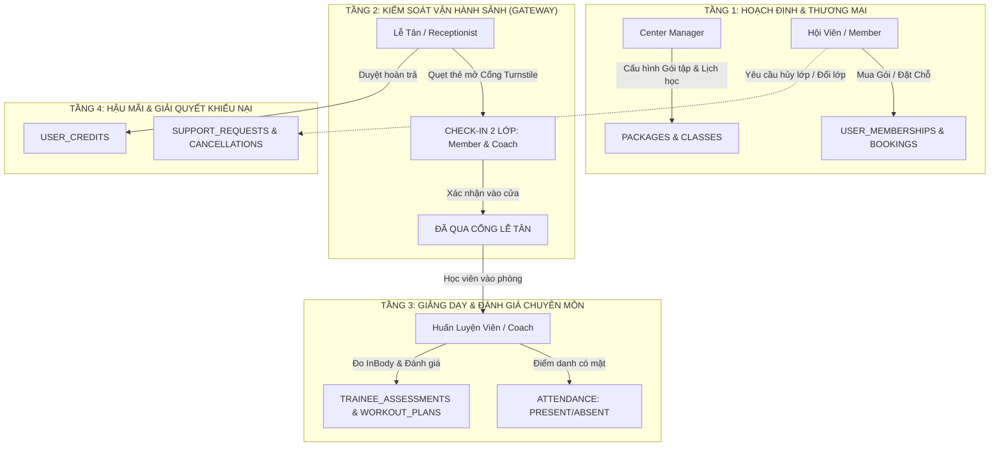
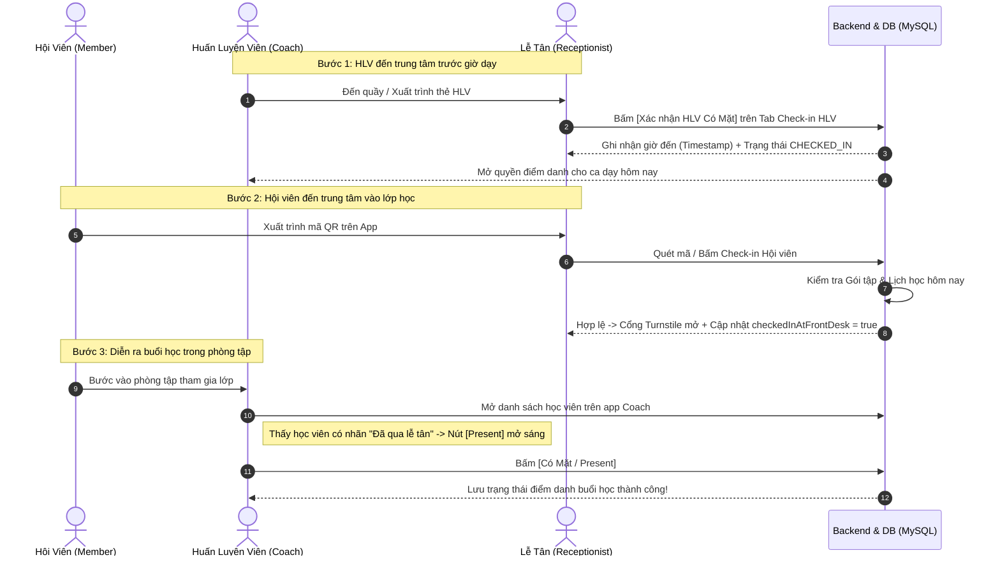
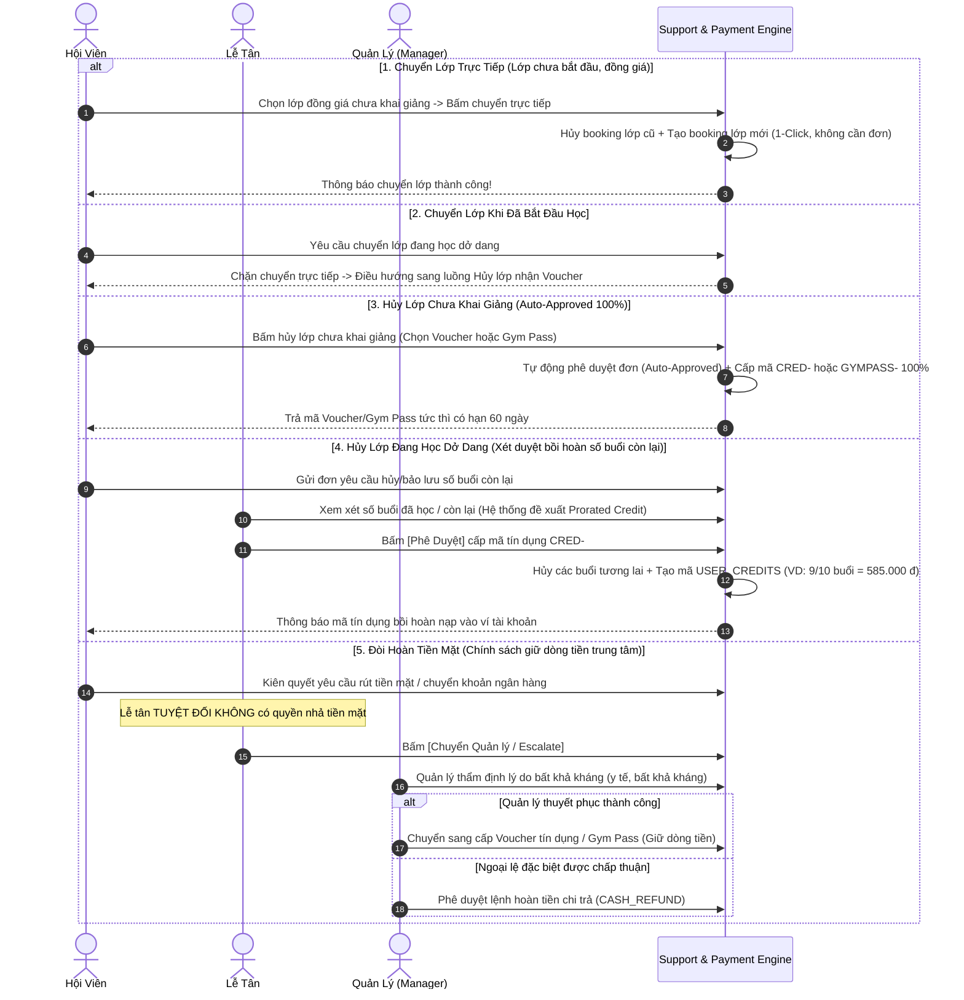

# TÀI LIỆU QUY LUẬN NGHIỆP VỤ & MA TRẬN VAI TRÒ TOÀN HỆ THỐNG
## (SPORTS CENTER BUSINESS ARCHITECTURE & ROLE INTERACTION MATRIX)

> **Tài liệu được tổng hợp và quy luận ngược từ 100% mã nguồn thực tế (Backend Spring Boot, Frontend React, CSDL MySQL và Bản mô phỏng 2.5D Simulator)**.

---

## MỤC LỤC
1. [Nguyên Lý Cốt Lõi Của Hệ Thống (Core Domain Principles)](#1-nguyên-lý-cốt-lõi-của-hệ-thống)
2. [Bản Đồ Thực Thể & Vòng Đời Dữ Liệu (Domain Entities & Lifecycles)](#2-bản-đồ-thực-thể--vòng-đời-dữ-liệu)
3. [Phân Định 4 Vai Trò & Ma Trận Phân Quyền (RACI Matrix)](#3-phân-định-4-vai-trò--ma-trận-phân-quyền)
4. [Các Ràng Buộc Nghiệp Vụ Cốt Tử (Hard Business Constraints)](#4-các-ràng-buộc-nghiệp-vụ-cốt-tử)
5. [Chuỗi Tương Tác Đa Chiều Giữa Các Vai Trò (Cross-Role Workflows)](#5-chuỗi-tương-tác-đa-chiều-giữa-các-vai-trò)
6. [Cơ Chế Chống Lỗi Ngầm & Xử Lý Đồng Thời (Concurrency & Edge-Cases Defense)](#6-cơ-chế-chống-lỗi-ngầm--xử-lý-đồng-thời)

---

## 1. NGUYÊN LÝ CỐT LÕI CỦA HỆ THỐNG



### 1.1. Mô hình Trung tâm Phức hợp Lai (Hybrid Multi-Sport Facility)
Hệ thống không vận hành như một phòng Gym đơn lẻ, mà quản lý một tổ hợp thể thao 3 tầng gồm 5 phòng bộ môn chuyên biệt (`ROOMS`):
1. **Phòng Gym Tầng 1** (Sức chứa 50 - Thể hình tự do)
2. **Phòng Yoga Tầng 2** (Sức chứa 30 - Lớp Yoga Hatha, Vinyasa)
3. **Phòng Zumba Tầng 3** (Sức chứa 40 - Nhảy hiện đại, Dance Fitness)
4. **Bể Bơi Bốn Mùa Tầng 1** (Sức chứa 100 - Bơi lội & Thể thao dưới nước)
5. **Phòng Đạp Xe Spinning Tầng 2** (Sức chứa 20 - Đạp xe cường độ cao)

Trung tâm cung cấp **2 phương thức tập luyện đồng thời**:
* **Tự do (Free Access):** Vào khu gym, bơi, xông hơi không cần HLV theo gói thời hạn.
* **Theo lớp có HLV (Coach-led Structured Sessions):** Phải đặt chỗ (`BOOKING`), giới hạn sĩ số (`max_slots`), tuân thủ ca dạy cố định (`SCHEDULES`).

### 1.2. Nguyên lý Snapshot Dữ liệu Bất biến (Financial & Benefit Snapshot)
Khi hội viên mua một gói tập, toàn bộ quyền lợi (giá tiền, thời hạn, danh sách phòng được phép vào, số buổi học) được **chụp lại (Snapshot)** vào bản ghi `USER_MEMBERSHIPS` (`package_name_snapshot`, `price_snapshot`, `type_name_snapshot`, `MEMBERSHIP_BENEFIT_ROOMS`).  
$\rightarrow$ **Ý nghĩa:** Nếu sau này Quản lý tăng giá gói hoặc cắt giảm số phòng tập của gói đó trên hệ thống, quyền lợi của những hội viên đã mua trước đó **không bao giờ bị thay đổi hay phương hại**.

---

## 2. BẢN ĐỒ THỰC THỂ & VÒNG ĐỜI DỮ LIỆU

### 2.1. Vòng đời Gói tập & Quyền lợi (`USER_MEMBERSHIPS`)
```
[GIAO DỊCH MUA THÀNH CÔNG]
          │
          ▼
   ┌───────────────┐
   │   UPCOMING    │ (Nếu ngày bắt đầu > Hôm nay)
   └───────┬───────┘
           │ (Đến ngày bắt đầu HOẶC Lễ tân Kích Hoạt Sớm tại quầy)
           ▼
   ┌───────────────┐
   │    ACTIVE     │ (Trong khoảng: start_date <= today <= end_date)
   └───────┬───────┘
           │ (Hết hạn ngày kết thúc HOẶC hết số buổi remaining_sessions)
           ▼
   ┌───────────────┐
   │    EXPIRED    │ (Vô hiệu hóa quyền vào cửa)
   └───────────────┘
```

### 2.2. Vòng đời Buổi Đặt Chỗ (`BOOKINGS`)
```
[HỘI VIÊN ĐẶT CHỖ TRÊN APP / LỄ TÂN ĐĂNG KÝ]
          │
          ▼
   ┌───────────────┐
   │   CONFIRMED   │ (Giữ 1 slot trong lớp, trừ 1 lượt session_limit)
   └───────┬───────┘
           │
           ├──────────────────────────────┬──────────────────────────────┐
           ▼                              ▼                              ▼
   ┌───────────────┐              ┌───────────────┐              ┌───────────────┐
   │   CANCELLED   │              │    PRESENT    │              │    ABSENT     │
   │ (Hủy trước ca │              │ (Qua lễ tân + │              │ (Không đến,   │
   │ hoàn lại slot)│              │  HLV xác nhận)│              │  bị trừ lượt) │
   └───────────────┘              └───────────────┘              └───────────────┘
```

---

## 3. PHÂN ĐỊNH 4 VAI TRÒ & MA TRẬN PHÂN QUYỀN (RACI MATRIX)

| Nghiệp vụ / Hành động | Center Manager (Quản Lý) | Receptionist (Lễ Tân) | Coach (Huấn Luyện Viên) | Member (Hội Viên) |
| :--- | :---: | :---: | :---: | :---: |
| **Cấu hình Gói tập, Giá tiền, Bộ môn** | **A / R** (Toàn quyền) | I (Chỉ xem) | I (Chỉ xem) | I (Chỉ xem) |
| **Tạo Lớp học, Phân bổ HLV & Phòng** | **A / R** (Toàn quyền) | I | I | I |
| **Xếp Lịch Học (`SCHEDULES`)** | **A / R** | I | I (Xem lịch cá nhân) | I (Xem lịch trống) |
| **Bán Gói Tập & Thu Tiền Tại Quầy** | I (Xem doanh thu) | **A / R** (Thực hiện) | - | C (Người mua) |
| **Mua Gói Tập & Đặt Lớp Trực Tuyến** | - | - | - | **A / R** |
| **Check-in Vào Cửa Cho Hội Viên** | I (Giám sát) | **A / R** (Mở cổng) | - | C (Quẹt mã QR) |
| **Check-in / Chấm Công Cho HLV** | I (Theo dõi chuyên cần) | **A / R** (Xác nhận) | C (Có mặt) | - |
| **Điểm Danh Học Viên Trong Lớp** | I | - | **A / R** (Xác nhận) | I |
| **Soạn Giáo Án & Bài Tập Thể Lực** | - | - | **A / R** (Chuyên môn) | I (Nhận bài tập) |
| **Đo & Đánh Giá Chỉ Số InBody** | - | - | **A / R** (Chấm điểm) | **R** (Tự ghi nhận) |
| **Hủy Lớp / Đổi Lớp Hạn Chế** | A (Duyệt ca đặc biệt) | **R** (Xử lý tại quầy) | I (Nhận thông báo) | **R** (Gửi yêu cầu) |

*Ghi chú RACI:* **A** (Accountable - Chịu trách nhiệm chính), **R** (Responsible - Trực tiếp thực hiện), **C** (Consulted - Tham vấn/Phối hợp), **I** (Informed - Nhận thông tin/Xem).

---

## 4. CÁC RÀNG BUỘC NGHIỆP VỤ CỐT TỬ (HARD CONSTRAINTS)

### 4.1. Ràng Buộc Không Gian & Thời Gian (Anti-Collision Constraints)
1. **Phòng tập (Room Constraint):** Trong cùng một khoảng thời gian $[StartTime, EndTime]$, một phòng tập (`room_id`) **chỉ được phép gán cho duy nhất 1 ca học**.
2. **Huấn luyện viên (Coach Constraint):** Một HLV (`coach_id`) **không thể dạy 2 lớp khác nhau trong cùng một khung giờ** hoặc có ca học đè lên nhau.
3. **Sĩ số lớp (Capacity Constraint):** Tổng số `BOOKINGS` có trạng thái `CONFIRMED` **không bao giờ được vượt quá** `max_slots` của lớp hoặc `capacity` của phòng tập tương ứng.

### 4.2. Ràng Buộc Kiểm Soát Cửa 2 Lớp (Double-Check In Enforcement)
1. **Điều kiện để Member được vào sảnh:**
   $$\text{Access Granted} \iff (\text{Active Gym Membership Hôm nay}) \lor (\text{Có Booking Class Hôm nay } \land \text{CONFIRMED})$$
2. **Khóa cứng điểm danh HLV:**
   HLV **bị khóa nút "Có Mặt" (Present)** nếu học viên chưa qua quầy lễ tân check-in (`st.checkedInAtFrontDesk = false`). HLV không thể "điểm danh khống" cho người không có mặt ở trung tâm.

### 4.3. Ràng Buộc Hủy Lớp Theo Mốc Giờ (Class Cancellation Policy)
Hệ thống áp dụng công thức 3 mốc thời gian chặt chẽ tính từ thời điểm hiện tại tới giờ học ($T = StartTime - CurrentTime$):
* **$T \ge 12\text{ giờ}$:** Hội viên được quyền **Tự Hủy Trực Tuyến** $\rightarrow$ Hệ thống hoàn lại 100% lượt tập vào gói tập ngay lập tức.
* **$2\text{ giờ} \le T < 12\text{ giờ}$ (Hủy muộn):** Hệ thống khóa hủy tự động $\rightarrow$ Chuyển thành **Yêu Cầu Hỗ Trợ (`SUPPORT_REQUESTS`)** gửi tới Lễ tân. Lễ tân thẩm tra lý do bất khả kháng để quyết định cấp mã bồi hoàn tín dụng (`USER_CREDITS`).
* **$T < 2\text{ giờ}$ hoặc đã qua giờ học:** **Khóa hủy tuyệt đối**. Buổi tập được tính là đã thực hiện hoặc vắng mặt không phép (`ABSENT`) để đảm bảo quyền lợi và phụ cấp đứng lớp cho Huấn luyện viên đã đến trung tâm.

---

## 5. CHUỖI TƯƠNG TÁC ĐA CHIỀU GIỮA CÁC VAI TRÒ

### 5.1. Luồng 1: Vận hành Vào Cửa & Điểm Danh (Check-in & Attendance Lifecycle)



---

### 5.2. Luồng 2: Đo Đạc InBody & Phân Tách Quyền Đánh Giá

* **Tình huống 1: Hội viên tự đo (Self-Log):**
  * Hội viên vào Dashboard $\rightarrow$ bấm **[Tự cập nhật chỉ số]** $\rightarrow$ nhập Cân nặng, Chiều cao, % Mỡ, Cơ bắp và Ghi chú cá nhân.
  * Backend lưu với `coach = user`, `performanceRating = null`, `recommendation = null`.
  * Dashboard hiển thị: **Người ghi nhận: Chính bạn (Tự đo)**, tiêu đề **Ghi chú & Mục tiêu cá nhân**. Ẩn toàn bộ sao đánh giá và mục tiêu giả.
* **Tình huống 2: HLV đo và đánh giá sau buổi học (Coach Assessment):**
  * HLV mở danh sách học viên $\rightarrow$ bấm **[Đánh giá buổi tập]** $\rightarrow$ nhập điểm Kỹ thuật (1-5 sao), Chuyên cần (1-5 sao), số đo thể chất và Lời khuyên/Mục tiêu cho buổi tới.
  * Dashboard hội viên hiển thị: Tên HLV, tên lớp, số sao thực tế và phác đồ rèn luyện chuyên môn.

---

### 5.3. Luồng 3: Chuyển Lớp, Hủy Lớp, Bảo Lưu Học Phí & Quản Trị Dòng Tiền



#### Nguyên tắc vận hành cốt lõi:
1. **Chuyển lớp linh hoạt trước giờ G**: Học viên tự chuyển 1-click trước khi lớp bắt đầu. Khi lớp đã học $\ge 1$ buổi, chặn tự chuyển để tránh lệch tiến độ chuyên môn $\rightarrow$ phải qua luồng bảo lưu lấy voucher đăng ký lớp mới.
2. **Cơ chế Kép của Thẻ Gym Pass (`GYMPASS-`)**: Vừa dùng để nhập pass tại cửa ra vào tập Gym tự do, vừa có thể sử dụng như một Voucher giảm trừ trong Giỏ hàng khi mua gói tập/lớp học khác.
3. **Prorated Credit Engine**: Tính tiền bồi hoàn chính xác theo số buổi thực tế chưa học ($Price \times Remaining / Total$), làm tròn đến hàng nghìn đồng.
4. **Bảo toàn dòng tiền (Cash Retention Defense)**: Tiền đã vào trung tâm được ưu tiên giữ lại bằng Store Credit hoặc Gym Pass. Cửa xuất tiền mặt chỉ mở duy nhất qua thẩm quyền Quản lý.

---

## 6. CƠ CHẾ CHỐNG LỖI NGẦM & XỬ LÝ ĐỒNG THỜI (CONCURRENCY DEFENSE)

### 6.1. Chống Tranh Chấp Cửa & Trùng Lặp Check-in (Race Condition Defense)
* Khi 2 lễ tân cùng bấm Check-in cho cùng 1 hội viên tại 2 quầy khác nhau ở cùng 1 phần nghìn giây:
  * Hệ thống dùng **Pessimistic Locking (`FOR UPDATE`)** tại `bookingRepository.lockOperations()`.
  * Giao dịch nào đến trước 1ms sẽ chiếm khóa, ghi nhận check-in.
  * Giao dịch đến sau bị hàng đợi giữ lại; khi mở khóa, hệ thống kiểm tra thấy hội viên này đã ở trạng thái `CHECKED_IN` trong ngày $\rightarrow$ **Ném ngoại lệ chặn đứng ngay lập tức**, không bao giờ bị trừ 2 lần lượt tập.

### 6.2. Chống Trùng Mã Ca Dạy HLV (Exact Integer Schedule ID Matching)
* Khi kiểm tra lịch sử chấm công HLV trong `AUDIT_LOGS`, hệ thống phân tích JSON và ép kiểu số nguyên tuyệt đối (`Objects.equals(loggedSchedId, schedule.getScheduleId())`), loại bỏ hoàn toàn lỗi nhận diện nhầm chuỗi con giữa ca có ID nhỏ (ví dụ: `5`) và ca có ID lớn (ví dụ: `50`).

### 6.3. Khả năng Chịu Tải & Tốc Độ Truy Vấn (Zero N+1 Query)
* Ở màn hình Lễ tân và Dashboard Hội viên, toàn bộ các bảng liên kết (`Schedule`, `GymClass`, `Coach`, `Room`, `Package`) đều được truy vấn qua **Batch Query / `JOIN FETCH` trong 1 - 2 câu SQL duy nhất**, thay vì truy vấn trong vòng lặp $O(N)$ $\rightarrow$ Tốc độ phản hồi đạt mức **15 - 30ms**, chịu tải tốt ngay cả khi hàng trăm học viên cùng ùa vào sảnh giờ cao điểm.
