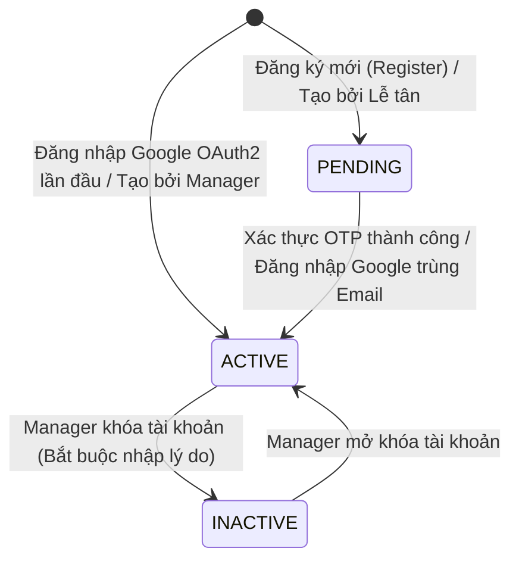
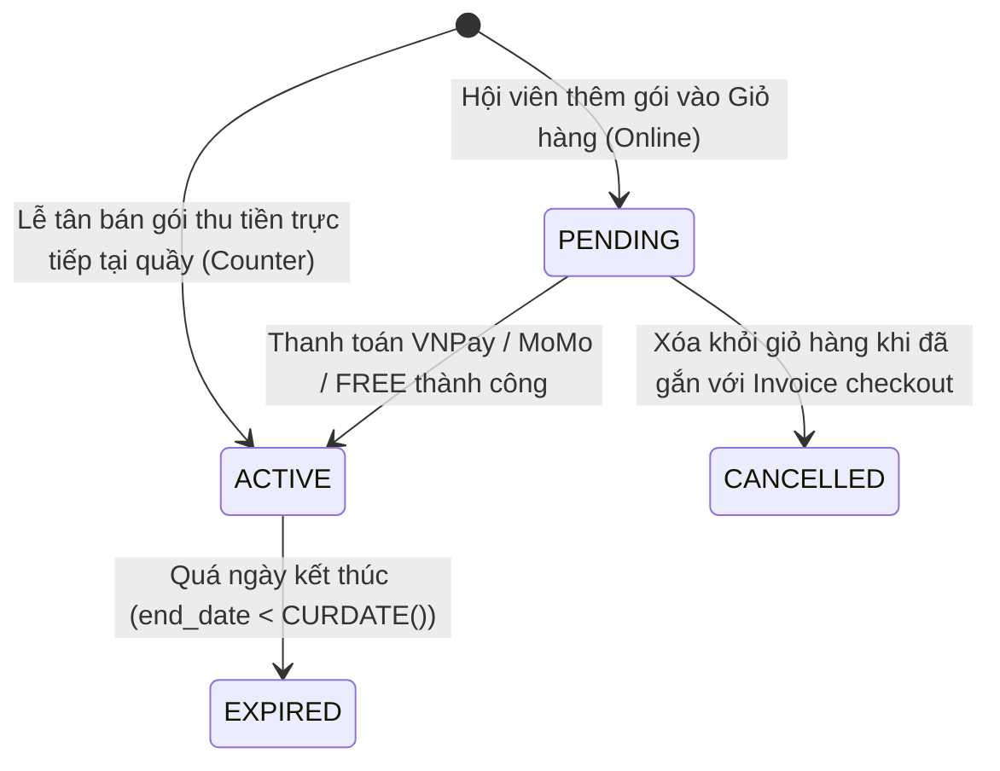
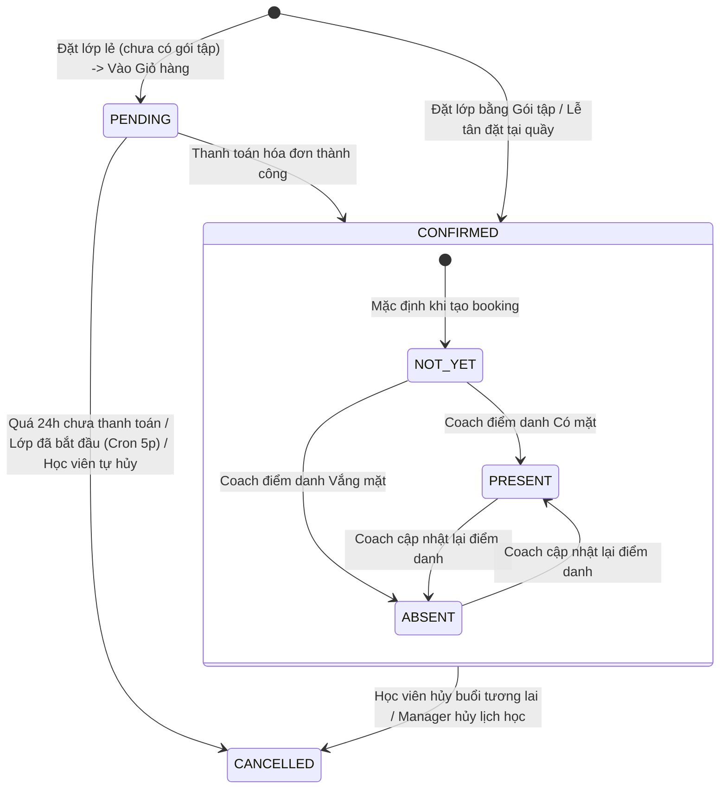
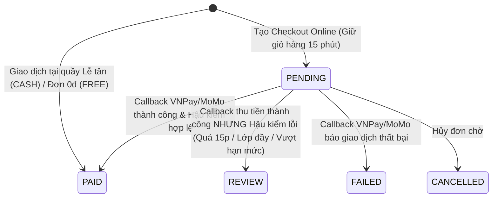
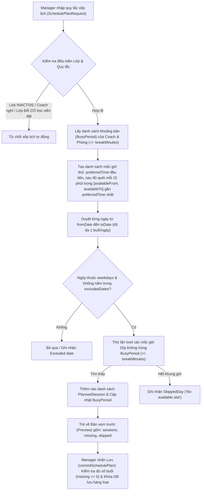
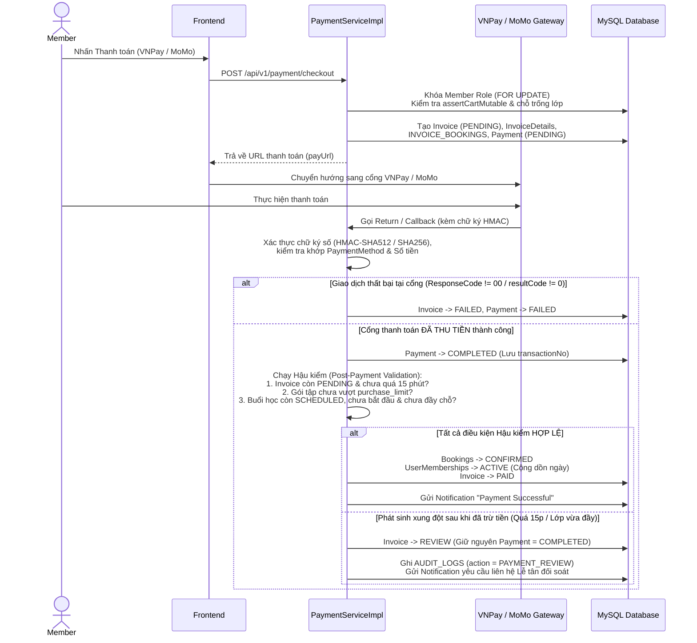
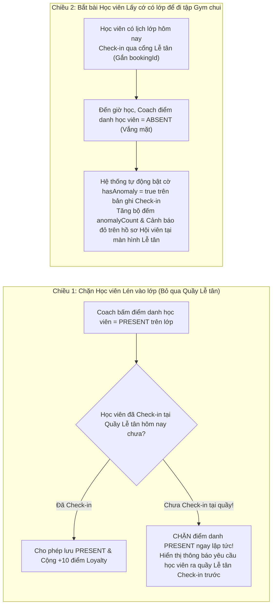

# TÀI LIỆU QUY TẮC NGHIỆP VỤ & LUỒNG XỬ LÝ TOÀN HỆ THỐNG (BUSINESS RULES & SYSTEM WORKFLOWS)

> **Dự án**: Hệ thống Quản lý Trung tâm Thể thao **NEXUS Sports Lab** (`SWP391`)  
> **Nguồn đối chiếu**: Trích xuất trực tiếp 100% từ mã nguồn thực tế (`Backend` Spring Boot & `Frontend` React/Vite). Không phụ thuộc vào các file hình ảnh sơ đồ cũ.  
> **Mục đích**: Tài liệu chuẩn hóa toàn bộ quy tắc nghiệp vụ (Business Rules), ràng buộc dữ liệu (Constraints), máy trạng thái (State Machines) và luồng xử lý đầu-cuối (End-to-End Workflows) để cả **Lập trình viên** và **AI Agent** đọc hiểu chính xác hành vi hệ thống.

---

## MỤC LỤC

1. [Tổng quan Hệ thống, Phân quyền (RBAC) & Kiểm soát Đồng thời](#1-tổng-quan-hệ-thống-phân-quyền-rbac--kiểm-soát-đồng-thời)
2. [Hệ thống Máy Trạng thái (State Machines & Lifecycles)](#2-hệ-thống-máy-trạng-thái-state-machines--lifecycles)
3. [Phân hệ 1: Xác thực, Vòng đời Tài khoản & Bảo mật (`auth`, `manager/users`)](#3-phân-hệ-1-xác-thực-vòng-đời-tài-khoản--bảo-mật)
4. [Phân hệ 2: Danh mục Gói tập, Snapshot Quyền lợi & Hạn mức Buổi học (`packages`, `benefits`)](#4-phân-hệ-2-danh-mục-gói-tập-snapshot-quyền-lợi--hạn-mức-buổi-học)
5. [Phân hệ 3: Vận hành Trung tâm: Bộ môn, Phòng tập, Lớp học & Xếp lịch Tự động (`manager/operations`)](#5-phân-hệ-3-vận-hành-trung-tâm-bộ-môn-phòng-tập-lớp-học--xếp-lịch-tự-động)
6. [Phân hệ 4: Đặt lịch Lớp học, Hủy lịch & Bảo lưu Hạn mức (`member/booking`, `receptionist/booking`)](#6-phân-hệ-4-đặt-lịch-lớp-học-hủy-lịch--bảo-lưu-hạn-mức)
7. [Phân hệ 5: Giỏ hàng, Thanh toán (VNPay/MoMo/Tiền mặt), Đối soát & Sổ cái Giao dịch (`payment`, `transactions`)](#7-phân-hệ-5-giỏ-hàng-thanh-toán-vnpaymomotiền-mặt-đối-soát--sổ-cái-giao-dịch)
8. [Phân hệ 6: Check-in Thông minh tại Quầy, Sức chứa Phòng & Đối soát chéo Lễ tân – Coach (`checkin`, `attendance`)](#8-phân-hệ-6-check-in-thông-minh-tại-quầy-sức-chứa-phòng--đối-soát-chéo-lễ-tân--coach)
9. [Phân hệ 7: Nghiệp vụ Huấn luyện viên, Giáo án, Đánh giá, Cronjob & Trợ lý NEXUS AI (`coach`, `notification`, `ai-chat`)](#9-phân-hệ-7-nghiệp-vụ-huấn-luyện-viên-giáo-án-đánh-giá-cronjob--trợ-lý-nexus-ai)
10. [Bảng Tham chiếu Nhanh Mã lỗi & Ràng buộc Cốt lõi](#10-bảng-tham-chiếu-nhanh-mã-lỗi--ràng-buộc-cốt-lõi)

---

## 1. Tổng quan Hệ thống, Phân quyền (RBAC) & Kiểm soát Đồng thời

### 1.1. Ma trận Tác nhân & Phân quyền Truy cập (RBAC)
Hệ thống định nghĩa 4 vai trò đã xác thực trong bảng `ROLES` cùng với tác nhân khách vãng lai (`Guest`). Quyền truy cập được kiểm soát kép tại [`SecurityConfig.java`](Backend/src/main/java/com/team4/sportscenter/common/config/SecurityConfig.java), [`JwtAuthenticationFilter.java`](Backend/src/main/java/com/team4/sportscenter/security/jwt/JwtAuthenticationFilter.java) và [`AppRoutes.jsx`](Frontend/src/routes/AppRoutes.jsx):

| Tác nhân (Role) | Tên trong DB (`ROLES.role_name`) | Spring Authority | Prefix API được phép truy cập | Trang đích mặc định (Frontend) |
| :--- | :--- | :--- | :--- | :--- |
| **Guest** (Khách) | *(Chưa đăng nhập)* | `permitAll()` | `/api/v1/auth/**`, `/api/guest/**`, `GET /api/avatars/**`, `GET /api/resource-images/**` | `/` (`HomePage`) |
| **Member** (Hội viên) | `Member` | `ROLE_MEMBER` | `/api/v1/member/**`, `/api/v1/payment/**`, `/api/v1/notifications/**` | `/member/dashboard` |
| **Receptionist** (Lễ tân) | `Receptionist` | `ROLE_RECEPTIONIST` | `/api/receptionist/**`, `/api/v1/notifications/**` | `/receptionist/members` |
| **Coach** (Huấn luyện viên) | `Coach` | `ROLE_COACH` | `/api/v1/coach/**`, `/api/coach/**`, `/api/v1/notifications/**` | `/coach/schedule` |
| **Center Manager** (Quản lý) | `Center Manager` | `ROLE_CENTER_MANAGER` | `/api/manager/**`, đồng thời có quyền truy cập `/api/receptionist/**` và `/api/v1/coach/**` | `/manager` |

### 1.2. Cơ chế Khóa Đồng thời (Database-Level Serialization Locks)
Để ngăn chặn triệt để lỗi Race Condition (hai người đặt chỗ cuối cùng cùng lúc, thanh toán trùng, hoặc Quản lý đổi phòng trong lúc hội viên đang đặt lớp), hệ thống sử dụng khóa bi quan (`SELECT ... FOR UPDATE`) cấp cơ sở dữ liệu trong cùng `@Transactional`:
- **Khóa tác vụ Quản lý (`ManagerRepository.lockOperations()`)**: Thực thi `SELECT role_id FROM ROLES WHERE role_name='Center Manager' FOR UPDATE` trước mọi thao tác thêm/sửa/xóa tài khoản, phòng tập, lớp học, lịch học và gói tập.
- **Khóa tác vụ Đặt lịch & Thanh toán (`BookingRepository.lockOperations()`)**: Thực thi `SELECT role_id FROM ROLES WHERE role_name='Member' FOR UPDATE` trước mọi thao tác đặt lớp, hủy lớp, thêm/xóa giỏ hàng, tạo hóa đơn checkout và xử lý IPN/Callback thanh toán.

---

## 2. Hệ thống Máy Trạng thái (State Machines & Lifecycles)

### 2.1. Vòng đời Tài khoản (`USERS.status`)

- **Quy tắc bổ sung**: Cờ `force_password_change = true` (mặc định khi Lễ tân tạo tài khoản cho khách tại quầy hoặc Manager bật cờ) buộc người dùng sau khi đăng nhập phải gọi API đổi mật khẩu lần đầu trước khi sử dụng hệ thống.

### 2.2. Vòng đời Gói tập của Hội viên (`USER_MEMBERSHIPS.status`)


### 2.3. Vòng đời Đặt lịch & Điểm danh (`BOOKINGS.status` & `attendance_status`)


### 2.4. Vòng đời Hóa đơn & Thanh toán (`INVOICES.status` & `PAYMENTS.status`)

- **Quy tắc Hiển thị Sổ cái (`TransactionService.PAYMENT_STATE`)**:
  - Nếu `INVOICES.status = 'REVIEW'` và `PAYMENTS.status IN ('SUCCESS', 'COMPLETED')` $\rightarrow$ Trạng thái giao dịch hiển thị là **`REVIEW`** (cần đối soát/hoàn tiền, **không** cộng vào doanh thu thực thu trên báo cáo Manager).
  - Nếu `PAYMENTS.status = 'COMPLETED'` và `INVOICES.status = 'PAID'` $\rightarrow$ Hiển thị là **`SUCCESS`**.

---

## 3. Phân hệ 1: Xác thực, Vòng đời Tài khoản & Bảo mật

**Mã nguồn chính**: [`UserServiceImpl.java`](Backend/src/main/java/com/team4/sportscenter/modules/auth/services/impl/UserServiceImpl.java), [`ManagerService.java`](Backend/src/main/java/com/team4/sportscenter/modules/manager/services/ManagerService.java), [`ReceptionistMemberServiceImpl.java`](Backend/src/main/java/com/team4/sportscenter/modules/receptionist/services/impl/ReceptionistMemberServiceImpl.java)

### 3.1. Đăng ký & Xác thực OTP (`registerUser`, `verifyAccount`)
1. **Kiểm tra trùng lặp Email & Số điện thoại**:
   - Nếu Email đã tồn tại và có `status != 'PENDING'` $\rightarrow$ Báo lỗi `"Email đã tồn tại và đã được kích hoạt trên hệ thống!"`.
   - Nếu Số điện thoại đã tồn tại ở một tài khoản khác (khác Email đang đăng ký) $\rightarrow$ Báo lỗi `"Số điện thoại đã được sử dụng bởi một tài khoản khác!"`.
2. **Cơ chế Tái sử dụng Tài khoản `PENDING`**:
   - Nếu người dùng từng đăng ký trước đó nhưng chưa nhập OTP (`status = 'PENDING'`), hệ thống **không tạo dòng mới** mà cập nhật lại Họ tên, SĐT, Mật khẩu mã hóa `BCrypt` trên bản ghi cũ và sinh mã OTP mới.
3. **Sinh và Xác thực OTP**:
   - Mã OTP gồm **6 chữ số** ngẫu nhiên (`100000` – `999999`), lưu trong bộ nhớ RAM (`ConcurrentHashMap<String, String> otpStorage`) theo khóa là `email` và gửi qua SMTP (`EmailService`).
   - Khi người dùng gọi `/api/v1/auth/verify` với đúng mã OTP: Xóa OTP khỏi RAM, chuyển `status` từ `PENDING` $\rightarrow$ `ACTIVE`, khởi tạo `loyaltyPoints = 0`, và gửi thông báo chào mừng (`WELCOME`).

### 3.2. Đăng nhập & Google OAuth2 (`loginUser`, `loginWithGoogle`)
1. **Đăng nhập thường (`Email + Password`)**:
   - Chỉ tài khoản có `status = 'ACTIVE'` mới được phép đăng nhập (`User.isEnabled()` trả về `"ACTIVE".equalsIgnoreCase(status)`).
   - Trả về JWT Token kèm cờ `forcePasswordChange`. Nếu `forcePasswordChange == true`, Frontend tự động chuyển hướng sang màn hình bắt buộc đổi mật khẩu.
2. **Đăng nhập bằng Google (`loginWithGoogle`)**:
   - Gọi Google UserInfo API (`https://www.googleapis.com/oauth2/v3/userinfo`) bằng `accessToken` để lấy `email` và `name` thật từ Google.
   - **Tài khoản chưa tồn tại**: Tự động tạo tài khoản mới với Role `Member`, `status = 'ACTIVE'`, mật khẩu ngẫu nhiên `UUID`, `loyaltyPoints = 0` và gửi thông báo chào mừng.
   - **Tài khoản đang `PENDING`**: Tự động kích hoạt lên `status = 'ACTIVE'` vì email đã được Google xác thực.
   - **Tài khoản đang `INACTIVE`**: Từ chối đăng nhập (`"Tài khoản của bạn đã bị khóa hoặc ngưng hoạt động!"`).

### 3.3. Quên mật khẩu & Đổi Email Bảo mật (`forgotPassword`, `changeEmail`)
1. **Quên mật khẩu**:
   - Lưu OTP vào `otpStorage` với khóa `<email>_FORGOT`. Khi đặt lại mật khẩu (`resetPassword`), mật khẩu mới phải có độ dài tối thiểu **6 ký tự**.
2. **Đổi Email tài khoản đang đăng nhập**:
   - Kiểm tra mật khẩu hiện tại phải khớp và `newEmail` chưa từng tồn tại trên hệ thống.
   - Lưu OTP vào `otpStorage` với khóa `<currentEmail>_CHANGE_EMAIL_<newEmail>` và gửi OTP tới **email mới**.
   - Sau khi xác nhận OTP thành công (`confirmEmailChange`): Cập nhật email mới, phát hành lại **JWT Token mới** (vì `subject` của JWT là email), tạo thông báo hệ thống và gửi **Email Cảnh báo Bảo mật (`sendSecurityAlertEmail`)** về địa chỉ **email cũ**.

### 3.4. Tạo Hội viên tại Quầy Lễ tân (`ReceptionistMemberServiceImpl.createMember`)
- Lễ tân tạo tài khoản cho khách trực tiếp tại quầy sẽ có `Role = Member`, `status = 'ACTIVE'` ngay lập tức.
- Hệ thống tự sinh **mật khẩu tạm thời 8 ký tự** (chữ và số), gắn cờ `forcePasswordChange = true` và gửi mật khẩu tạm qua email cho khách hàng.

### 3.5. Quy tắc Quản trị Tài khoản của Center Manager (`ManagerService`)
1. **Ràng buộc Mật khẩu**: Từ **6 ký tự** trở lên và không vượt quá **72 bytes UTF-8** (giới hạn chuẩn của thuật toán BCrypt).
2. **Bảo vệ Tài khoản Đang đăng nhập (Self-Protection)**: Manager đang đăng nhập **không thể** tự xóa, tự khóa (`INACTIVE`), hoặc tự hạ quyền (`roleId`) của chính mình.
3. **Bảo vệ Quản lý Cuối cùng (`validateLastManager`)**: Hệ thống luôn phải có ít nhất **01 tài khoản `Center Manager` ở trạng thái `ACTIVE`**. Mọi thao tác xóa, khóa hoặc đổi quyền của Manager cuối cùng đều bị chặn (`"The last active manager cannot be locked or demoted"`).
4. **Bảo vệ Huấn luyện viên Đang phụ trách lớp (`validateCoachChange`)**: Không được phép khóa (`INACTIVE`), xóa hoặc đổi Role của một `Coach` nếu Coach đó đang phụ trách lớp `ACTIVE` hoặc còn buổi dạy `SCHEDULED` trong tương lai (`coachHasAssignments`). Phải bàn giao lớp cho Coach khác trước.
5. **Bắt buộc Lý do Khóa tài khoản**: Khi chuyển trạng thái tài khoản sang `INACTIVE` qua API `PATCH /api/manager/users/{id}/status`, trường `reason` là **bắt buộc** và được lưu vào `AUDIT_LOGS`.

### 3.6. Quy tắc Xử lý File Ảnh (`AvatarStorageService` & `ResourceImageStorageService`)
- **Ảnh đại diện (`uploads/avatars`)**: Dung lượng tối đa **2 MB**, kiểm tra trực tiếp **Magic Bytes** đầu file (`89 50 4E 47` cho `.png`, `FF D8 FF` cho `.jpg`), không tin vào đuôi file do client gửi lên.
- **Ảnh tài nguyên Bộ môn / Phòng / Lớp / Gói tập (`uploads/resource-images`)**: Dung lượng tối đa **2 MB**, độ phân giải tối đa **16 Megapixels** (`width * height <= 16,000,000`). Hệ thống giải mã (`BufferedImage`) và **mã hóa lại (re-encode)** thành file `.jpg` nền trắng, thu phóng cạnh dài nhất về tối đa **1600px** để loại bỏ hoàn toàn mã độc nhúng trong ảnh.
- **Đồng bộ Transaction (`TransactionSynchronization`)**: Khi thay ảnh mới, nếu DB transaction bị rollback thì chỉ xóa file mới vừa tải lên; nếu transaction commit thành công thì mới xóa file ảnh cũ trên ổ đĩa.

---

## 4. Phân hệ 2: Danh mục Gói tập, Snapshot Quyền lợi & Hạn mức Buổi học

**Mã nguồn chính**: [`PackageTypeCatalog.java`](Backend/src/main/java/com/team4/sportscenter/modules/manager/services/PackageTypeCatalog.java), [`PackageBenefitsService.java`](Backend/src/main/java/com/team4/sportscenter/modules/member/services/PackageBenefitsService.java), [`PackageCommerceService.java`](Backend/src/main/java/com/team4/sportscenter/modules/member/services/PackageCommerceService.java)

### 4.1. Phân loại Gói tập (`PACKAGE_TYPES`)
Mỗi loại gói tập có thuộc tính cốt lõi `requires_subjects` (`boolean`):
1. **Nhóm không yêu cầu bộ môn (`requires_subjects = false`)**: Điển hình là `GYM_ACCESS` (Tập Gym tự do). Gói này **không được phép** cấu hình danh sách bộ môn (`benefits` phải rỗng).
2. **Nhóm yêu cầu bộ môn (`requires_subjects = true`)**: Điển hình là `CLASS_PASS` (Gói lớp học), `COMBO` (Gym + Lớp học), hoặc các loại gói tùy chỉnh `CUSTOM_<UUID>` do Manager tạo thêm. Bắt buộc phải cấu hình ít nhất **01 quyền lợi bộ môn**.

### 4.2. Quy tắc Cấu hình Gói tập & Quyền lợi (`savePackage`)
1. **Thông số Thương mại (`PackageCommerceService`)**:
   - `sellingStatus`: Chỉ nhận `SELLING` (Đang mở bán) hoặc `STOPPED` (Ngừng bán). Gói `STOPPED` bị ẩn khỏi trang cửa hàng của Guest/Member và không thể mua mới, nhưng các hội viên đã mua trước đó vẫn sử dụng bình thường.
   - `purchaseLimitPerMember`: Giới hạn số lần mua tối đa trên mỗi hội viên (`null` = Không giới hạn, hoặc số nguyên từ `1` đến `1000`).
   - `description`, `includedText`, `termsText`: Tối đa `4000` ký tự mỗi trường.
2. **Định nghĩa Quyền lợi Bộ môn & Phòng tập (`PackageBenefitsService.saveDefinition`)**:
   - Tối đa **100 bộ môn** trong một gói tập; không được lặp lại cùng một `subjectId` trong cùng một gói.
   - Số buổi học được cấp cho mỗi bộ môn (`sessions`): Phải nằm trong khoảng **`1` đến `10.000` buổi**.
   - Phạm vi phòng tập cho từng bộ môn (`roomIds`):
     - Nếu để trống (`roomIds` rỗng) $\rightarrow$ **Áp dụng tất cả các phòng (`allRooms = true`)**.
     - Nếu chọn danh sách phòng cụ thể $\rightarrow$ Tối đa **100 phòng**, chỉ học được các lớp thuộc bộ môn đó tổ chức tại các phòng nằm trong danh sách.

### 4.3. Cơ chế Bất biến Hóa Quyền lợi khi Mua (`Immutable Membership Snapshot`)
Khi hội viên thêm gói vào giỏ hàng (`addPackageToCart`), mua tại quầy Lễ tân (`assignPackage`), hoặc thanh toán, hệ thống gọi `packageBenefits.snapshot(membership)` và `snapshotSubjects(membershipId, packageId)`:
- Sao chép toàn bộ tên gói, mã loại gói, tên loại gói, số ngày hiệu lực, giá tiền vào các cột `*_snapshot` trong bảng `USER_MEMBERSHIPS`.
- Sao chép toàn bộ định nghĩa bộ môn và số buổi vào bảng `MEMBERSHIP_SUBJECT_BENEFITS` và phạm vi phòng vào `MEMBERSHIP_BENEFIT_ROOMS`.
- **Hệ quả nghiệp vụ**: Khi Manager sửa giá, giảm số buổi, đổi phòng hoặc ngừng bán gói tập gốc trên bảng `PACKAGES`, **quyền lợi của các gói hội viên đã mua hoặc đang giữ trong giỏ hàng hoàn toàn không bị thay đổi**. Mọi thay đổi gói tập của Manager đều được ghi vết chi tiết (`before` vs `after`) vào `AUDIT_LOGS`.

### 4.4. Quy tắc Kiểm tra Hạn mức Mua (`checkPurchase`)
Một hội viên chỉ được phép mua hoặc giữ gói trong đơn checkout khi:
- Gói tập đang có `selling_status = 'SELLING'`.
- Nếu gói có `purchase_limit_per_member = L` ($L \ge 1$):
  $$\text{Số lượt đã tính} = \text{Count}(\text{Gói đã mua thành công}) + \text{Count}(\text{Đơn PENDING trong 15 phút gần nhất})$$
  Nếu $\text{Số lượt đã tính} \ge L$ $\rightarrow$ Ném lỗi `PackageRuleException("PACKAGE_PURCHASE_LIMIT_REACHED")`.

### 4.5. Quy tắc Cộng dồn Ngày Hiệu lực khi Mua nhiều Gói (`Stacking Duration`)
Khi kích hoạt gói tập mới (tại `PaymentServiceImpl.finishPayment` hoặc `ReceptionistMemberServiceImpl.assignPackage`):
- **Trường hợp 1 (Gói không yêu cầu môn học – VD: `GYM_ACCESS`)**: Tìm ngày kết thúc muộn nhất (`latestEndDate`) trong số tất cả các gói `ACTIVE` cùng loại (`packageType`) của hội viên. Gói mới sẽ bắt đầu từ `latestEndDate + 1 ngày` (cộng dồn nối tiếp thời gian).
- **Trường hợp 2 (Gói có môn học – VD: `CLASS_PASS`, `COMBO`)**:
  - Nếu hội viên mua **cùng `package_id`** đang `ACTIVE`: Cộng dồn nối tiếp ngày (`startDate = latestEndDate + 1`).
  - Nếu hội viên mua một **`package_id` khác** (ví dụ đang học gói Yoga, mua thêm gói Boxing): Kích hoạt chạy song song ngay từ hôm nay (`startDate = LocalDate.now()`), mỗi gói quản lý quỹ buổi học (`MEMBERSHIP_SUBJECT_BENEFITS`) độc lập.

---

## 5. Phân hệ 3: Vận hành Trung tâm: Bộ môn, Phòng tập, Lớp học & Xếp lịch Tự động

**Mã nguồn chính**: [`ManagerService.java`](Backend/src/main/java/com/team4/sportscenter/modules/manager/services/ManagerService.java), [`ManagerRepository.java`](Backend/src/main/java/com/team4/sportscenter/modules/manager/repositories/ManagerRepository.java), [`SchedulePlanner.java`](Backend/src/main/java/com/team4/sportscenter/modules/manager/services/SchedulePlanner.java)

### 5.1. Quy tắc Quản lý Phòng tập (`saveRoom`)
- Sức chứa phòng (`capacity`) không bao giờ được chỉnh sửa xuống thấp hơn `max_slots` lớn nhất của các lớp học đã được gán vào phòng đó (`capacity >= requiredRoomCapacity(roomId)`).

### 5.2. Quy tắc Quản lý Lớp học (`saveClass`)
1. **Điều kiện Gán Huấn luyện viên & Phòng**:
   - Coach được gán phải có Role `Coach` và đang ở trạng thái `ACTIVE`.
   - Sức chứa tối đa của lớp (`maxSlots`) không được vượt quá sức chứa của phòng (`maxSlots <= room.capacity`).
2. **Bảo vệ Lớp học Đã có Học viên Đăng ký (`id != null`)**:
   - **Cấm đổi Bộ môn (`subjectId`)**: Nếu lớp đã có bất kỳ booking nào chưa hủy (`hasClassBookings(id)`), không được phép chuyển lớp sang bộ môn khác.
   - **Chặn giảm Sĩ số dưới số chỗ đã đặt**: `maxSlots` mới phải $\ge$ số lượng học viên đã đặt (`CONFIRMED` + `PENDING`) cao nhất ở bất kỳ buổi học nào của lớp (`peakBookings(id)`).
   - **Kiểm tra Xung đột khi Đổi Coach hoặc Đổi Phòng**:
     - Không được trùng giờ với bất kỳ buổi học `SCHEDULED`/`COMPLETED` nào khác của Coach mới hoặc Phòng mới (`hasAssignmentConflict`).
     - Phòng mới phải nằm trong danh sách phòng hợp lệ của tất cả các gói tập mà học viên đã dùng để đặt lớp này (`packageBenefits.validateClassRoom`).
   - **Điều kiện Ngừng hoạt động Lớp (`INACTIVE`)**: Chỉ được chuyển lớp sang `INACTIVE` sau khi đã hủy toàn bộ các buổi học `SCHEDULED` trong tương lai (`!hasUpcomingSchedules(id)`).

### 5.3. Quy tắc Quản lý Buổi học Đơn lẻ & Chuỗi lịch (`saveSchedule`, `createScheduleSeries`)
1. **Tính bất biến của Buổi học đã kết thúc**: Buổi học đã ở trạng thái `COMPLETED` hoặc `CANCELLED` **không thể chỉnh sửa** (nếu cần dạy bù, phải tạo buổi học mới).
2. **Điều kiện Hoàn thành (`COMPLETED`)**: Chỉ được chuyển sang `COMPLETED` khi thời gian kết thúc của buổi học đã qua (`endTime <= LocalDateTime.now()`).
3. **Điều kiện Đổi giờ Buổi học (`timingChanged`)**:
   - Giờ bắt đầu mới phải nằm ở tương lai (`startTime > NOW()`).
   - Không trùng lịch với các buổi học khác của Coach hoặc Phòng (`hasScheduleConflict`).
   - Không trùng lịch học cá nhân của bất kỳ học viên nào đã đăng ký buổi học đó (`hasMemberConflict`).
   - Thời gian mới vẫn phải nằm trong khoảng ngày hiệu lực (`[start_date, end_date]`) của gói tập mà học viên đã dùng để đặt buổi đó (`packageBenefits.validateSessionDates`).
   - Tự động gửi thông báo `"Thay đổi lịch học"` đến tất cả học viên đã đặt buổi đó.
4. **Hủy Buổi học (`CANCELLED`)**:
   - Khi hủy hoặc hoàn thành buổi học, không được đồng thời sửa giờ hoặc đổi lớp.
   - Khi chuyển sang `CANCELLED`, hệ thống tự động hủy toàn bộ booking của buổi đó (`UPDATE BOOKINGS SET status='CANCELLED'`) — nhờ đó học viên đặt bằng gói tập được **tự động hoàn lại 1 buổi vào quỹ gói tập** — và bắn thông báo `"Buổi học đã hủy"` cho học viên.

### 5.4. Quy tắc Công cụ Xếp lịch Tự động (`SchedulePlanner`)

- **Ràng buộc thông số (`SchedulePlanner.validateRules`)**:
  - Khoảng ngày phải từ hôm nay trở đi, tối đa **366 ngày**.
  - Số buổi cần xếp (`sessions`): **`1` đến `52` buổi**.
  - Thời lượng mỗi buổi (`durationMinutes`): **`15` đến `240` phút**.
  - Thời gian nghỉ đệm giữa các ca (`breakMinutes`): **`0` đến `120` phút**.
  - Tối đa **01 buổi học mỗi ngày** cho lớp được xếp.

### 5.5. Ngưỡng Cảnh báo Vận hành trên Dashboard Manager (`ManagerRepository`)
- **Cảnh báo Lớp Ít Học viên (`LOW_REGISTRATION_THRESHOLD = 25%`)**: Các buổi học `SCHEDULED` trong 7 ngày tới có tổng số chỗ đặt (`CONFIRMED` + `PENDING`) `< 25%` sĩ số tối đa (`booked < max_slots * 0.25`).
- **Cảnh báo Khẩn cấp (`URGENT_WINDOW_HOURS = 6 giờ`)**: Các buổi học có tỷ lệ đặt chỗ `< 25%` và sắp bắt đầu trong vòng **6 giờ tới** được tách riêng lên đầu bảng điều khiển để Manager kịp thời quyết định hủy hoặc ghép lớp.
- **Cảnh báo Sắp hết hạn Gói tập (`Renewal Page`)**: Liệt kê các gói hội viên `ACTIVE` sẽ hết hạn trong vòng **7 ngày tới**.

---

## 6. Phân hệ 4: Đặt lịch Lớp học, Hủy lịch & Bảo lưu Hạn mức

**Mã nguồn chính**: [`MemberServiceImpl.java`](Backend/src/main/java/com/team4/sportscenter/modules/member/services/impl/MemberServiceImpl.java), [`PackageBenefitsService.java`](Backend/src/main/java/com/team4/sportscenter/modules/member/services/PackageBenefitsService.java), [`ReceptionistMemberServiceImpl.java`](Backend/src/main/java/com/team4/sportscenter/modules/receptionist/services/impl/ReceptionistMemberServiceImpl.java)

### 6.1. Cơ chế Đặt Lớp theo Khóa học của Hội viên (`bookCourse`)
Trên cổng Hội viên (`Member`), việc đăng ký lớp học được thực hiện theo **toàn bộ các buổi học tương lai của lớp đó**:
1. **Kiểm tra điều kiện**:
   - Hội viên chưa có booking (`CONFIRMED` hoặc `PENDING`) tại lớp này (`!existsByEmailAndClassId`).
   - Lớp còn ít nhất 1 buổi `SCHEDULED` trong tương lai.
   - Số chỗ đã đặt cao nhất trong tất cả các buổi tương lai của lớp chưa chạm trần `maxSlots`.
   - **Kiểm tra Chống trùng lịch cá nhân (`Time Overlap Validation`)**: Duyệt từng buổi của lớp mới so với toàn bộ các buổi học chưa hủy (`status != 'CANCELLED'`) của hội viên. Nếu tồn tại bất kỳ cặp buổi học nào thỏa mãn:
     $$\text{Start}_{\text{new}} < \text{End}_{\text{existing}} \quad \text{AND} \quad \text{Start}_{\text{existing}} < \text{End}_{\text{new}}$$
     $\rightarrow$ Chặn đặt lớp và chỉ rõ tên lớp/thời gian bị trùng.
2. **Hai luồng xử lý sau khi qua bước kiểm tra**:
   - **Luồng A – Đặt lẻ qua Giỏ hàng (`POST /api/v1/member/book-class/{classId}`)**:
     - Tạo các bản ghi `Booking` với `status = 'PENDING'`, `attendance_status = 'NOT_YET'`. Các buổi này lập tức giữ chỗ tạm thời và xuất hiện trong Giỏ hàng chờ thanh toán.
   - **Luồng B – Đặt bằng Gói tập Đang có (`POST /api/v1/member/book-class/{classId}/with-package/{membershipId}`)**:
     - Gọi `packageBenefits.reserve()` để kiểm tra 5 điều kiện của gói tập:
       1. Gói tập thuộc sở hữu của hội viên và đang `ACTIVE` (chưa quá hạn `end_date`).
       2. Ngày diễn ra của **tất cả các buổi học** phải nằm trọn trong khoảng `[start_date, end_date]` của gói tập.
       3. Gói tập có quyền lợi cho bộ môn (`subjectId`) của lớp học.
       4. Phòng học (`roomId`) của lớp nằm trong phạm vi phòng được phép của quyền lợi đó.
       5. Số buổi còn lại của bộ môn trong gói (`remainingSessions`) $\ge$ Tổng số buổi của khóa học.
     - Nếu thỏa mãn: Tạo ngay các bản ghi `Booking` với `status = 'CONFIRMED'` (không cần qua giỏ hàng) và ghi liên kết vào bảng `BOOKING_BENEFITS`.

### 6.2. Công thức Tính & Hoàn Hạn mức Buổi học (`BOOKING_BENEFITS`)
Số buổi đã sử dụng (`usedSessions`) của một quyền lợi bộ môn trong gói tập được tính trực tiếp bằng truy vấn:
```text
SELECT COUNT(*) FROM BOOKING_BENEFITS bb
JOIN BOOKINGS b ON b.booking_id = bb.booking_id
WHERE bb.membership_benefit_id = ?
  AND (b.status <> 'CANCELLED' OR b.attendance_status = 'PRESENT')
```
- **Ý nghĩa nghiệp vụ**:
  - Buổi học đang `CONFIRMED` (chưa học, hoặc vắng mặt `ABSENT`) sẽ tính là **đã dùng 1 buổi**.
  - Nếu buổi học được hủy (`status = 'CANCELLED'`) khi học viên **chưa tham gia (`attendance_status != 'PRESENT'`)**, buổi đó **không còn bị đếm** $\rightarrow$ Hệ thống tự động hoàn trả lại hạn mức buổi vào gói tập cho hội viên.
  - Nếu học viên **đã điểm danh có mặt (`PRESENT`)**, buổi học đó luôn được tính là đã sử dụng dù trạng thái booking có thay đổi.

### 6.3. Chính sách Chuyển Lớp học (Class Transfer Policy)
- **Mã nguồn**: `SupportRequestServiceImpl.getTransferClassPreview`, `transferClassDirectly`.
- **Trường hợp 1 – Lớp chưa khai giảng (`hasStarted == false`): Tự chuyển trực tiếp 1-click**:
  - Hội viên được phép tự đổi sang lớp khác ngay trên giao diện mà **không cần tạo đơn hỗ trợ**.
  - **Điều kiện ràng buộc**:
    1. Học phí lớp mục tiêu phải **bằng đúng** học phí lớp hiện tại (`targetPrice == currentPrice`).
    2. Lớp mục tiêu đang `ACTIVE`, chưa khai giảng (`firstSessionTime > NOW()`), và còn chỗ trống (`maxSlots`).
    3. Hội viên không bị trùng lịch cá nhân với các buổi học của lớp mới.
  - **Cơ chế xử lý**: Khóa đồng thời (`lockOperations()`), đánh dấu `CANCELLED` toàn bộ booking của lớp cũ, đồng thời tạo các booking `CONFIRMED` mới ở lớp mục tiêu.
- **Trường hợp 2 – Lớp đã khai giảng hoặc đã có buổi học diễn ra (`hasStarted == true`): Chặn chuyển trực tiếp**:
  - Hệ thống **chặn tuyệt đối** hành vi tự chuyển lớp (`"Không thể chuyển lớp: Khóa học hiện tại đã bắt đầu hoặc đã có buổi học diễn ra."`).
  - **Lý do nghiệp vụ**: Các lớp khác nhau về tiến độ giáo trình, số buổi đã học và Huấn luyện viên phụ trách.
  - **Luồng xử lý**: Hội viên bắt buộc phải vào luồng **Hủy lớp** (Mục 6.4) để được bồi hoàn số buổi còn lại thành Voucher tín dụng `CRED-`, sau đó dùng voucher đó để đăng ký lớp học mới trong Giỏ hàng.

### 6.4. Chính sách Hủy Lớp, Bảo lưu Học phí & Phân loại Quyền lợi (Class Cancellation & Retention)
- **Mã nguồn**: `SupportRequestServiceImpl.getCancelClassPreview`, `cancelClassDirectly`, `respondToRequest`.
- **Trường hợp A – Hủy lớp trước ngày khai giảng (`hasStarted == false`): Tự động Phê duyệt (Auto-Approved)**:
  - Khi hội viên hủy lớp chưa bắt đầu:
    - Hệ thống tự động tính toán **100% học phí** lớp học.
    - Học viên chọn loại hình bồi hoàn yêu thích (`preferredResolution`):
      1. **Voucher Tín dụng Lớp học (`ISSUE_CREDIT`)**: Cấp mã voucher tín dụng `CRED-xxx` trị giá 100% học phí (hạn 60 ngày), dùng áp giảm trừ trong Giỏ hàng.
      2. **Thẻ tập Gym Pass (`GYMPASS-xxx`)**: Cấp mã thẻ tập Gym Pass 01 tháng (giá trị tương đương hoặc nhỏ hơn các gói gym có trong Package Store).
    - Hệ thống tự động sinh một đơn `SupportRequest` lưu vết kiểm toán (Audit Trail) với trạng thái **`APPROVED` ngay lập tức** (Auto-Approved), sinh mã voucher tương ứng và thông báo cho học viên mà không cần chờ Lễ tân duyệt thủ công.
- **Trường hợp B – Hủy lớp khi đang học dở dang (`hasStarted == true`): Xét duyệt Bồi hoàn qua Lễ tân**:
  - Học viên bắt buộc gửi đơn yêu cầu hỗ trợ (`POST /api/v1/member/support/requests`) kèm lý do (chấn thương, bận việc, chuyển chỗ ở, v.v.).
  - Đơn được chuyển về cổng tiếp nhận của Lễ tân (`SupportDeskView`).
  - **Công thức tính tiền bồi hoàn (Prorated Credit Calculation)**:
    $\text{Credit Bồi hoàn} = \text{Học phí lớp} \times \frac{\text{Số buổi còn lại}}{\text{Tổng số buổi}} \quad (\text{Làm tròn đến hàng nghìn VNĐ})$
    *Ví dụ*: Lớp Spinning RPM (10 buổi, học phí 650.000 đ), học viên đã học 1 buổi (còn 9 buổi):
    $\text{Tiền bồi hoàn} = 650.000 \times \frac{9}{10} = \mathbf{585.000}\text{ đ}$
  - Khi Lễ tân duyệt đơn:
    1. Sinh mã tín dụng `CRED-xxx` trị giá đúng số tiền bồi hoàn đã tính (585.000 đ), hạn dùng 60 ngày.
    2. Đánh dấu `CANCELLED` toàn bộ các buổi học tương lai chưa điểm danh của lớp.
    3. Gửi thông báo và phản hồi chính thức vào hòm thư tài khoản của hội viên.

### 6.5. Chính sách Quản lý Dòng tiền & Thẩm quyền Duyệt Hoàn Tiền Mặt (Center Manager Cash Refund Escalation)
- **Nguyên tắc cốt tử: "Bảo vệ tối đa dòng tiền trung tâm (Cash Retention)"**:
  - Dòng tiền đã nạp vào trung tâm phải được ưu tiên tuyệt đối giữ lại qua hình thức Store Credit hoặc Gym Pass.
  - **Phân định thẩm quyền**: Nhân viên Lễ tân **TUYỆT ĐỐI KHÔNG CÓ QUYỀN** duyệt hoàn tiền mặt hoặc chuyển khoản ngân hàng.
- **Quy trình Chuyển cấp Quản lý (`ESCALATE` to Center Manager)**:
  - Nếu học viên kiên quyết từ chối voucher và yêu cầu lấy lại tiền mặt/chuyển khoản $\rightarrow$ Lễ tân chọn hành động **`ESCALATE`** (Chuyển Quản lý giải quyết).
  - Trạng thái đơn chuyển sang `ESCALATED`. Lễ tân không thể can thiệp hay sửa đổi đơn này nữa.
  - Quản lý trung tâm (`Center Manager`) trực tiếp thẩm định các lý do bất khả kháng đặc biệt (bệnh lý nặng có giấy chứng nhận của bệnh viện, định cư xa, sự cố lỗi dịch vụ từ phía trung tâm).
  - Quản lý có toàn quyền:
    - Bác bỏ yêu cầu hoàn tiền nếu không thỏa mãn chính sách, giải thích và định hướng hội viên chuyển sang nhận Voucher/Gym Pass.
    - Hoặc phê duyệt lệnh hoàn tiền mặt (`CASH_REFUND`) chuyển bộ phận Kế toán xuất quỹ/chuyển khoản hoàn trả học viên.

### 6.6. Cơ chế Kép của Thẻ Gym Pass (`GYMPASS-xxx`)
Thẻ tập Gym Pass (`GYMPASS-`) được thiết kế với cơ chế sử dụng 2-trong-1 linh hoạt:
1. **Sử dụng tại Cửa ra vào phòng Gym (Turnstile Door Check-in)**:
   - Học viên có thể đưa mã `GYMPASS-xxx` hoặc nhập pass tại cửa/quầy Lễ tân để check-in mở cổng vào tập Gym tự do không giới hạn số lượt trong thời hạn của thẻ (30 ngày).
2. **Sử dụng như Voucher giảm giá trong Giỏ hàng (Store Credit)**:
   - Nếu học viên không có nhu cầu đến phòng gym tập tự do, học viên hoàn toàn có thể sử dụng mã `GYMPASS-xxx` như một Voucher tín dụng trong Giỏ hàng để khấu trừ tiền khi đăng ký lớp học mới hoặc mua gói tập khác.

### 6.7. Khấu trừ Voucher Tín dụng trong Giỏ hàng (`PaymentCart` & `PaymentService`)
- **Hiển thị Voucher khả dụng**: Khi hội viên mở Giỏ hàng (`/member/cart`), hệ thống tự động gọi `GET /api/v1/member/support/credits` để tải danh sách các thẻ tín dụng (`CRED-` và `GYMPASS-`) đang `ACTIVE` và còn số dư (`remainingAmount > 0`).
- **Khấu trừ tự động**:
  - Hội viên chọn mã voucher áp dụng tại dropdown *"Apply Course Credit Voucher"*.
  - Bảng Tóm tắt đơn hàng (Order Summary) hiển thị rõ dòng khấu trừ:
    $\text{Tổng thanh toán} = \max\left(0, \text{Tiền sau chiết khấu hạng} - \text{Số dư Voucher}\right)$
- **Xử lý Checkout (`PaymentServiceImpl.checkout`)**:
  - **Trường hợp Voucher $\ge$ Tổng tiền giỏ hàng**: Tổng tiền thanh toán về **`0 đ`**. Hệ thống lập tức hoàn tất đơn hàng, xác nhận các lớp học/gói tập thành công với mã giao dịch `CREDIT-<creditCode>` mà **không cần chuyển hướng qua cổng VNPay/MoMo**.
  - **Trường hợp Voucher < Tổng tiền giỏ hàng**: Voucher được trừ hết số dư (`remainingAmount = 0`, `status = USED`). Số tiền chênh lệch còn lại được chuyển sang cổng VNPay hoặc MoMo để học viên thanh toán bình thường.

### 6.8. Gia hạn Khóa học & Bán Gói tập tại Quầy Lễ tân (`ReceptionistMemberServiceImpl`)
1. **Gợi ý & Xác nhận Gia hạn Lớp học tại Quầy (`suggestNextClassRenewal`, `confirmClassRenewal`)**:
   - Từ một `bookingId` hiện tại của hội viên, hệ thống tìm các buổi học tương lai của các lớp cùng tên (`findUpcomingSchedulesByClassName`) bắt đầu sau thời điểm kết thúc khóa cũ, ưu tiên khớp đúng khung giờ học trong ngày và còn chỗ trống (`booked < maxSlots`).
   - Khi Lễ tân xác nhận (`POST /api/receptionist/classes/confirm-renewal`), hệ thống khóa đồng thời (`lockOperations()`), kiểm tra chống đặt trùng và sĩ số, sau đó tạo `Booking` mới với `status = 'CONFIRMED'`, `attendance_status = 'NOT_YET'`.
2. **Bán Gói tập trực tiếp tại quầy (`POST /api/receptionist/packages/subscribe`)**:
   - Kiểm tra quy tắc giới hạn mua (`commerce.checkPurchase`).
   - Cho phép chọn ngày bắt đầu (`startDate`, mặc định là hôm nay), tự tính `endDate = startDate + durationDays - 1`.
   - Tạo `UserMembership` (`status = 'ACTIVE'`, `purchaseSource = 'COUNTER'`), chụp Snapshot quyền lợi (`snapshot` & `snapshotSubjects`), đồng thời tạo `Invoice` (`PAID`) + `InvoiceDetail` + `PaymentEntity` (`COMPLETED`, phương thức `CASH`, mã giao dịch `COUNTER-<invoiceId>`).

---

## 7. Phân hệ 5: Giỏ hàng, Thanh toán (VNPay/MoMo/Tiền mặt), Đối soát & Sổ cái Giao dịch

**Mã nguồn chính**: [`PaymentServiceImpl.java`](Backend/src/main/java/com/team4/sportscenter/modules/payment/services/impl/PaymentServiceImpl.java), [`TransactionService.java`](Backend/src/main/java/com/team4/sportscenter/modules/manager/services/TransactionService.java)

### 7.1. Cơ chế Giỏ hàng & Khóa Giỏ hàng 15 Phút (`assertCartMutable`)
- Giỏ hàng của Hội viên là tập hợp các bản ghi `Booking` có `status = 'PENDING'` (gom nhóm theo `GymClass`) và các bản ghi `UserMembership` có `status = 'PENDING'`.
- **Quy tắc Khóa Giỏ hàng (`PACKAGE_CHECKOUT_PENDING`)**: Khi hội viên nhấn Thanh toán (`checkout`), một hóa đơn `Invoice(status = 'PENDING')` được tạo ra. Trong vòng **15 phút** kể từ `invoice.created_at`, nếu hóa đơn đó vẫn đang `PENDING`, hội viên **không được phép** thêm gói mới, xóa món trong giỏ hoặc tạo lượt checkout mới để tránh xung đột giao dịch đang xử lý trên cổng VNPay/MoMo.
- **Cơ chế Hủy Phiên Thanh toán Đang Chờ (`cancelPendingCheckout`)**:
  - Hội viên có thể chủ động hủy phiên checkout đang chờ qua nút *"Hủy / Quay lại giỏ hàng"* (tại trang VietQR), nút *"Hủy phiên thanh toán"* (tại banner giỏ hàng) hoặc tại trang Lịch sử hóa đơn.
  - Khi hủy: Hóa đơn và giao dịch chuyển thành `CANCELLED`, hoàn trả voucher tín dụng (nếu có), gỡ liên kết hóa đơn khỏi các món trong giỏ và mở khóa giỏ hàng ngay lập tức mà không cần đợi đủ 15 phút.
- **Quy tắc Xóa món khỏi Giỏ hàng (`removeFromCart`, `removePackageFromCart`)**:
  - Nếu món hàng chưa từng gắn với hóa đơn checkout nào: Xóa cứng (`DELETE`) bản ghi `PENDING` khỏi DB.
  - Nếu món hàng đã từng gắn với một hóa đơn checkout trước đó (đã quá 15 phút): Chuyển `status = 'CANCELLED'` để bảo toàn tham chiếu lịch sử hóa đơn.

### 7.2. Chính sách Giảm giá Tự động theo Hạng Điểm Tích lũy (`Loyalty Tier Discount`)
Khi tạo hóa đơn Checkout Online (`PaymentServiceImpl.checkout`), tổng tiền (`totalAmount`) được tự động nhân với hệ số chiết khấu dựa trên `user.loyaltyPoints`:

| Hạng Hội viên | Điểm tích lũy (`loyaltyPoints`) | Mức giảm giá | Hệ số nhân (`discountFactor`) |
| :--- | :--- | :---: | :---: |
| **Standard (Mặc định)** | `< 500` điểm | `0%` | `1.00` |
| **SILVER** | `500` – `1.499` điểm | **`5%`** | `0.95` |
| **GOLD** | `1.500` – `2.999` điểm | **`10%`** | `0.90` |
| **PLATINUM** | `>= 3.000` điểm | **`15%`** | `0.85` |

*(Tổng tiền sau giảm được làm tròn `HALF_UP` về số nguyên VNĐ. Nếu `totalAmount == 0`, đơn hàng hoàn tất ngay lập tức với mã giao dịch `FREE-<invoiceId>`).*

### 7.3. Luồng Thanh toán VNPay / MoMo & Cơ chế Hậu kiểm (`finishPayment` & Trạng thái `REVIEW`)


### 7.4. Luồng Thanh toán Tiền Thật vào Tài khoản Ngân hàng (VietQR / PayOS)
- **Mã nguồn**: [`PayOSConfig.java`](Backend/src/main/java/com/team4/sportscenter/config/PayOSConfig.java), [`PaymentServiceImpl.java`](Backend/src/main/java/com/team4/sportscenter/modules/payment/services/impl/PaymentServiceImpl.java), [`PaymentCart.jsx`](Frontend/src/features/member/pages/PaymentCart.jsx), [`VietQRPayment.jsx`](Frontend/src/features/member/pages/VietQRPayment.jsx), [`PaymentResult.jsx`](Frontend/src/features/member/pages/PaymentResult.jsx).
- **Hai chế độ vận hành linh hoạt**:
  1. **Chế độ Điền Trực tiếp Tài khoản Ngân hàng (Dễ vận hành nhất - Khuyên dùng cho Demo/Vận hành nhanh)**:
     - Quản trị viên chỉ cần khai báo 3 dòng trong `application.properties`:
       - `vietqr.bank-id`: Mã/tên ngân hàng (ví dụ: `MB`, `VCB`, `TCB`, `ICB`, `BIDV`, `ACB`,...)
       - `vietqr.account-no`: Số tài khoản ngân hàng thật của bạn.
       - `vietqr.account-name`: Tên chủ tài khoản người nhận.
     - Khi hội viên bấm thanh toán, hệ thống tạo mã VietQR Napas 247 chuẩn (chuẩn EMVCo Napas). Hội viên quét mã bằng bất kỳ App ngân hàng nào $\rightarrow$ **Tiền chuyển thẳng 100% vào tài khoản thật của bạn**.
     - Hội viên nhấn nút **"Tôi đã chuyển khoản thành công"** $\rightarrow$ Hệ thống gọi `POST /api/v1/payment/vietqr-confirm/{invoiceId}` để kích hoạt tức thì gói tập/buổi học và điều hướng sang trang kết quả thành công.
     - Hệ thống có cơ chế tự động thăm dò (polling mỗi 4 giây) để tự chuyển trang khi đơn hàng chuyển trạng thái `PAID`.
  2. **Chế độ Cổng PayOS Merchant (Tích hợp nâng cao)**:
     - Nếu có tài khoản cổng PayOS, điền `payos.clientId`, `payos.apiKey`, `payos.checksumKey`.
     - Hệ thống tự động sinh liên kết PayOS Checkout và nhận Webhook thời gian thực (`POST /api/v1/payment/payos-webhook`) kèm đối soát chữ ký số HMAC-SHA256.
- **Tính bất biến & Idempotent**: Cơ chế `finishPayment` kiểm tra trạng thái khóa `PAID`/`REVIEW`, đảm bảo không bao giờ kích hoạt quyền lợi hai lần.

---

## 8. Phân hệ 6: Check-in Thông minh tại Quầy, Sức chứa Phòng & Đối soát chéo Lễ tân – Coach

**Mã nguồn chính**: [`ReceptionistMemberServiceImpl.java`](Backend/src/main/java/com/team4/sportscenter/modules/receptionist/services/impl/ReceptionistMemberServiceImpl.java), [`CoachScheduleServiceImpl.java`](Backend/src/main/java/com/team4/sportscenter/modules/coach/services/impl/CoachScheduleServiceImpl.java), [`MemberCheckInView.jsx`](Frontend/src/features/receptionist/components/MemberCheckInView.jsx)

### 8.1. Ma trận 4 Trường hợp Quyền lợi Check-in (`checkInMember`)
Khi Lễ tân chọn một hội viên tại màn hình Check-in, hệ thống tự động phân tích quyền lợi hiện có trong ngày (không bắt lễ tân chọn thủ công giữa 2 mục đích cồng kềnh):
1. **Kiểm tra trạng thái đang ở trong trung tâm**: Nếu hội viên đã có lượt `CHECKED_IN` trong ngày hôm nay và chưa `CHECK_OUT`, hệ thống chặn tạo lượt check-in trùng và yêu cầu Check-out trước (`POST /api/receptionist/checkin/{checkInId}/checkout`).
2. **Hỗ trợ Kích hoạt sớm Gói tập (`activateEarly = true`)**: Nếu hội viên có gói `ACTIVE` nhưng ngày bắt đầu (`startDate`) ở tương lai, Lễ tân có thể tích chọn kích hoạt sớm để dời `startDate` về hôm nay (`today`) và cập nhật lại `endDate = today + duration - 1`.
3. **Ma trận 4 trường hợp tự động**:

| Trường hợp | Có gói tập hiệu lực hôm nay (`hasGymAccess`) | Có lịch lớp hôm nay (`hasTodayClass`) | Phân loại (`checkInType`) | Mã mở cửa phòng Gym (`accessCode`) | Hành vi Hệ thống & Giao diện Lễ tân |
| :--- | :---: | :---: | :--- | :--- | :--- |
| **TH 1** | ❌ Không | ❌ Không | *(Từ chối)* | `null` | **Khóa nút Check-in**. Yêu cầu hội viên đăng ký gói tập hoặc lớp học trước khi vào trung tâm. |
| **TH 2** | ❌ Không | ✅ Có | `CLASS_SESSION` | **`null` (Không cấp mã)** | Chỉ cấp quyền vào lớp học (`classAccessGranted = true`, `gymAccessGranted = false`). Tự động gắn `bookingId` và phòng học. Không cấp mã quét cửa khu Gym tự do. |
| **TH 3** | ✅ Có | ❌ Không | `GYM_FACILITY` | **`GYM-PASS-<uid>-<4so>`** | Cấp quyền vào khu Gym tự do (`gymAccessGranted = true`, `classAccessGranted = false`) kèm mã QR/Vòng tay mở cửa. |
| **TH 4** | ✅ Có | ✅ Có | `COMBO_ALL` | **`GYM-PASS-<uid>-<4so>`** | **Toàn quyền**: Cấp cả mã `GYM-PASS-...` để tập Gym tự do trước/sau giờ học lẫn liên kết `bookingId` để lên lớp điểm danh. |

*(Mỗi lượt Check-in thành công tại quầy tự động cộng **+1 điểm tích lũy (`loyaltyPoints`)** cho hội viên và lưu bản ghi `entity_type = 'MEMBER_CHECKIN'` vào `AUDIT_LOGS`).*

### 8.2. Kiểm soát Sức chứa Phòng Tập Thời gian thực (`getFacilityRooms`)
Để theo dõi mật độ học viên trong từng phòng tập (`GET /api/receptionist/checkin/rooms`), số người hiện tại (`currentOccupancy`) của mỗi phòng được tính bằng tổng của:
1. Số hội viên đang ở trạng thái `CHECKED_IN` (chưa Check-out) trong ngày hôm nay tại phòng đó.
2. Số học viên có lịch học `CONFIRMED` (không vắng mặt `ABSENT`) của các ca học **đang diễn ra ngay tại thời điểm hiện tại** (`NOW() BETWEEN start_time AND end_time`) tại phòng đó — **loại trừ (`NOT IN`)** những học viên đã được đếm ở mục (1) để không bị cộng trùng.

### 8.3. Công nghệ Đối soát Chéo 2 Chiều giữa Lễ tân & Huấn luyện viên (`Bidirectional Cross-Checking`)
Hệ thống kết nối trực tiếp dữ liệu Check-in tại Quầy Lễ tân và dữ liệu Điểm danh tại Lớp của Huấn luyện viên để chặn đứng 2 hành vi gian lận:



---

## 9. Phân hệ 7: Nghiệp vụ Huấn luyện viên, Giáo án, Đánh giá, Cronjob & Trợ lý NEXUS AI

**Mã nguồn chính**: [`CoachProfileServiceImpl.java`](Backend/src/main/java/com/team4/sportscenter/modules/coach/services/impl/CoachProfileServiceImpl.java), [`CoachWorkoutServiceImpl.java`](Backend/src/main/java/com/team4/sportscenter/modules/coach/services/impl/CoachWorkoutServiceImpl.java), [`CoachAssessmentServiceImpl.java`](Backend/src/main/java/com/team4/sportscenter/modules/coach/services/impl/CoachAssessmentServiceImpl.java), [`BookingCleanupTask.java`](Backend/src/main/java/com/team4/sportscenter/modules/member/services/impl/BookingCleanupTask.java), [`SystemNotificationScheduler.java`](Backend/src/main/java/com/team4/sportscenter/modules/notification/services/impl/SystemNotificationScheduler.java), [`AiChatServiceImpl.java`](Backend/src/main/java/com/team4/sportscenter/modules/member/services/impl/AiChatServiceImpl.java)

### 9.1. Quy tắc Chuyên môn & Điểm danh của Huấn luyện viên (`Coach`)
1. **Ràng buộc Đổi Bộ môn Giảng dạy (`CoachProfileServiceImpl.updateCoachProfile`)**:
   - Mỗi Coach đăng ký bộ môn chuyên môn trong bảng `USER_SPECIALTIES`.
   - Nếu Coach muốn chuyển sang bộ môn khác, hệ thống kiểm tra `findActiveClassesByCoachAndSubject`. Nếu Coach vẫn còn bất kỳ lớp học nào đang `ACTIVE` hoặc còn lịch dạy `SCHEDULED` thuộc bộ môn cũ $\rightarrow$ **Chặn đổi bộ môn** (`canChangeSubject = false`) và liệt kê tên các lớp cần hoàn thành/bàn giao trước.
2. **Quy tắc Điểm danh Lớp học (`CoachScheduleServiceImpl.updateAttendance`)**:
   - Chỉ Coach phụ trách lớp của buổi học đó mới có quyền cập nhật điểm danh.
   - **Ràng buộc Ngày điểm danh nghiêm ngặt**: Chỉ cho phép điểm danh vào **đúng ngày diễn ra buổi học** (`sessionDate.isEqual(LocalDate.now())`). Chặn điểm danh cho buổi học ở tương lai hoặc chỉnh sửa buổi học đã qua trong quá khứ.
   - **Ràng buộc Đối soát Lễ tân**: Học viên bắt buộc phải có lượt Check-in tại quầy Lễ tân trong ngày hôm nay thì Coach mới có thể tích chọn `PRESENT`.
   - **Thưởng/Thu hồi Điểm tích lũy**: Khi chuyển sang `PRESENT`, học viên được cộng **+10 `loyaltyPoints`**; nếu đổi từ `PRESENT` sang `ABSENT`/`NOT_YET`, hệ thống thu hồi lại **-10 `loyaltyPoints`** (tối thiểu về `0`).

### 9.2. Giao Giáo án Tập luyện & Đánh giá Tiến độ Học viên (`Workout Plans & Assessments`)
1. **Giao Giáo án (`CoachWorkoutServiceImpl.assignWorkoutPlan`)**:
   - Bắt buộc có tiêu đề (`title`) và ít nhất **01 bài tập** (`exerciseDetails`). Nếu không truyền thông số chi tiết thì mặc định `sets = 3`, `reps = 10`, `restSeconds = 60`.
   - Hỗ trợ 2 chế độ giao bài (`targetType`):
     - `INDIVIDUAL`: Giao cho 1 học viên cụ thể (`studentUserId`).
     - `CLASS`: Giao hàng loạt cho tất cả học viên đã đăng ký (`CONFIRMED`) trong một lớp học (`classId`) do chính Coach đó phụ trách. Nếu lớp chưa có học viên nào $\rightarrow$ Báo lỗi.
   - Tự động gửi thông báo loại `WORKOUT` đến từng học viên nhận giáo án.
   - Chỉ Coach tạo giáo án mới có quyền xem chi tiết hoặc xóa giáo án đó.
2. **Đánh giá Tiến độ Học viên (`CoachAssessmentServiceImpl.createAssessment`)**:
   - Bắt buộc chọn học viên (`studentUserId`) và nhập nhận xét chuyên môn (`feedbackNote` không được rỗng).
   - Lưu các chỉ số cơ thể (`weight`, `height`, `bodyFatPercentage`, `muscleMass`) và thang điểm (`performanceRating`, `attendanceRating`), tự động liên kết với `Schedule`, `Booking` hoặc `CoachWorkoutPlan` và bắn thông báo loại `COACH` cho học viên.

### 9.3. Các Tiến trình Tự động Chạy Nền (`Spring @Scheduled` Cronjobs)
| Tên Tiến trình | Lịch chạy (`Cron / FixedRate`) | Quy tắc Xử lý Nghiệp vụ |
| :--- | :--- | :--- |
| **`BookingCleanupTask.cleanupExpiredPendingBookings`** | Mỗi **5 phút** (`fixedRate = 300000`) | Quét toàn bộ `Booking` có `status = 'PENDING'` thỏa mãn 1 trong 2 điều kiện:<br/>1. Đã tạo quá **24 giờ** (`bookingTime < NOW() - 24h`) mà chưa thanh toán.<br/>2. Buổi học đã bắt đầu (`schedule.startTime <= NOW()`).<br/>$\rightarrow$ Tự động chuyển `status = 'CANCELLED'` để nhả ghế trống cho người khác và gửi thông báo `SYSTEM` cho hội viên. |
| **`SystemNotificationScheduler.checkExpiringMemberships`** | **08:00 sáng** mỗi ngày (`0 0 8 * * ?`) | Quét tất cả `UserMembership` có `status = 'ACTIVE'` và `endDate == LocalDate.now().plusDays(3)` (còn đúng **3 ngày** là hết hạn). Gửi thông báo nhắc gia hạn (có kiểm tra chống gửi lặp theo tiêu đề). |
| **`SystemNotificationScheduler.sendClassRemindersForTomorrow`** | **19:00 tối** mỗi ngày (`0 0 19 * * ?`) | Quét tất cả `Booking` có `status = 'CONFIRMED'` có giờ học diễn ra vào **ngày mai** (`00:00:00` đến `23:59:59` ngày mai). Gửi thông báo nhắc lịch đi tập kèm tên lớp, phòng học và giờ bắt đầu. |

### 9.4. Trợ lý Ảo Thông minh NEXUS AI (`AiChatServiceImpl`)
1. **Kiến trúc RAG Thời gian thực (Real-time Retrieval-Augmented Generation)**:
   - Mỗi khi hội viên gửi tin nhắn tới `POST /api/v1/member/ai-chat`, hệ thống tự động truy vấn trực tiếp từ DB:
     1. Danh sách các gói tập đang mở bán (`SELLING`) kèm giá và thời hạn.
     2. Danh sách các lớp học khả dụng kèm tên HLV, ca học tiếp theo và số chỗ trống (`maxSlots - bookedSlots`).
     3. Lịch học sắp tới của chính hội viên đó (`myUpcomingBookings`).
   - Dữ liệu này được đóng gói vào System Prompt trước khi gọi Google Gemini API (với cơ chế Fallback tự động qua 5 model: `gemini-1.5-flash` $\rightarrow$ `gemini-2.0-flash` $\rightarrow$ `gemini-flash-latest` $\rightarrow$ `gemini-3.5-flash-lite` $\rightarrow$ `gemini-3.8-flash-lite`, giới hạn `maxOutputTokens = 500`).
2. **Chính sách Bảo vệ Phạm vi & Tiết kiệm Token (`Anti-Abuse Guardrail`)**:
   - **Chỉ trả lời**: Dịch vụ của NEXUS Sports Lab (gói tập, lớp học, lịch tập, thanh toán, cài đặt tài khoản) và kiến thức thể hình, kỹ thuật bài tập, dinh dưỡng thể thao.
   - **Từ chối bắt buộc**: Mọi câu hỏi ngoài lề (giải toán/lý/hóa, viết code, thời tiết, tán gẫu...) bị từ chối lịch sự trong **tối đa 1–2 câu ngắn (dưới 35 từ)** và **tuyệt đối không gắn thẻ `[ACTION:...]`**.
3. **Cơ chế Điều hướng & Thao tác Tự động trên Giao diện (`Agentic UI Action Tags`)**:
   - AI có thể đính kèm các thẻ lệnh ẩn ở cuối phản hồi để Frontend tự động thực thi:
     - `[ACTION:NAVIGATE:/member/settings | /member/schedule | /member/book-class | /member/package-store | /member/cart]`
     - `[ACTION:ADD_CART:<package_id>]`: Tự động thêm gói tập vào giỏ hàng và làm nổi bật thẻ gói tập.
     - `[ACTION:BOOK_CLASS:<class_id>]`: Tự động đặt lớp học (AI bắt buộc phải kiểm tra chống trùng lịch với `USER'S CURRENT BOOKED SCHEDULE` trước khi phát lệnh này).
     - `[ACTION:HIGHLIGHT_PACKAGE:<package_id>]` & `[ACTION:HIGHLIGHT_CLASS:<class_id>]`: Tự động cuộn và làm nổi bật gói tập/lớp học được gợi ý trên màn hình.

---

## 10. Bảng Tham chiếu Nhanh Mã lỗi & Ràng buộc Cốt lõi

Khi phát triển tính năng mới hoặc bảo trì hệ thống, cần tuân thủ nghiêm ngặt các mã lỗi nghiệp vụ (`PackageRuleException` & `IllegalArgumentException`) sau:

| Mã lỗi / Quy tắc | Điều kiện Kích hoạt | Ý nghĩa Nghiệp vụ |
| :--- | :--- | :--- |
| `PACKAGE_NOT_AVAILABLE` | Mua hoặc đặt giỏ một gói có `selling_status != 'SELLING'` | Gói tập đã ngừng bán (`STOPPED`). |
| `PACKAGE_PURCHASE_LIMIT_REACHED` | Số lần đã mua + đơn `PENDING` `< 15m` $\ge$ `purchase_limit_per_member` | Hội viên đã đạt trần số lần mua cho phép của gói tập này. |
| `PACKAGE_CHECKOUT_PENDING` | Thao tác sửa giỏ hàng hoặc tạo checkout mới khi đang có `Invoice(PENDING)` tạo trong `< 15 phút` | Giỏ hàng đang bị khóa tạm thời chờ thanh toán trực tuyến hoàn tất. |
| `PACKAGE_EXPIRED` | Đặt lớp bằng gói tập có `status != 'ACTIVE'` hoặc `end_date < CURDATE()` | Gói tập không còn hiệu lực. |
| `PACKAGE_DATE_RANGE_EXCEEDED` | Đặt lớp hoặc Manager dời lịch buổi học ra ngoài khoảng `[start_date, end_date]` của gói tập | Ngày học nằm ngoài thời hạn hiệu lực của gói tập hội viên đã dùng. |
| `PACKAGE_SUBJECT_NOT_COVERED` | Đặt lớp thuộc bộ môn không nằm trong `MEMBERSHIP_SUBJECT_BENEFITS` của gói | Gói tập không bao gồm bộ môn của lớp học này. |
| `PACKAGE_ROOM_NOT_COVERED` | Đặt lớp hoặc Manager đổi phòng lớp sang phòng không nằm trong `MEMBERSHIP_BENEFIT_ROOMS` | Gói tập của học viên không có quyền học tại phòng tập này. |
| `PACKAGE_QUOTA_EXCEEDED` | Số buổi còn lại (`allocated - used`) của bộ môn trong gói `<` Số buổi của khóa học | Không đủ số buổi còn lại trong gói tập để đăng ký toàn khóa. |
| **Chặn Điểm danh khi Chưa Check-in Quầy** | Coach tích `PRESENT` nhưng học viên chưa có bản ghi `MEMBER_CHECKIN` hôm nay | Ngăn chặn học viên đi thẳng lên lớp bỏ qua kiểm soát quầy Lễ tân. |
| **Cảnh báo Trốn Lớp (`hasAnomaly = true`)** | Học viên Check-in có gắn `bookingId` lớp học nhưng Coach điểm danh `ABSENT` | Phát hiện học viên mượn cớ có lịch học để vào trung tâm rồi trốn lớp đi tập chui. |
